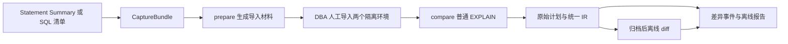

# 架构与文件契约

本文件描述当前 PCC Core 的公开接口与设计约束。功能的实际验证范围见 [validation.md](validation.md)；设计目标不能替代兼容性认证。

## 数据流



CLI 和 Python SDK 调用同一份核心。collector 负责 Summary、累计合并、筛选及依赖；capture 负责连接、SQL 守卫、EXPLAIN、取消和材料核验；plan 负责解析、匹配与差异；artifacts 负责文件发布、校验和与恢复；render 生成自包含 HTML 和 CSV。模块导入不连接数据库。

运行时为 CPython 3.11、PyMySQL 和 SQLGlot。SQLGlot 用于验证和依赖识别，不重写待测 SQL。工具不依赖平台服务、AI、Go、Docker 或任务队列。

## SQL 与参数

直接输入可使用 UTF-8 `.sql`，其中表名需要全限定；也可使用 JSONL，每行提供 `schema`、`sql_text`，以及可选的 `context`、`parameters` 和来源信息。SQL 原文、Hint、字面量与参数分别保留。

参数由 `type` 与 `value` 构成：

| 类型 | value 格式 |
|---|---|
| int / uint | 十进制字符串，64 位有符号/无符号范围 |
| decimal | 十进制字符串，最多65位精度、30位小数 |
| double | 有限浮点数字符串 |
| string | Unicode 字符串 |
| bytes | 十六进制字符串 |
| date | YYYY-MM-DD |
| datetime | YYYY-MM-DD HH:MM:SS.ffffff |
| time | [-]HHH:MM:SS.ffffff |
| json | 合法 JSON 字符串，绑定时转换为 SQL JSON |
| bool | JSON true / false |
| null | JSON null |

`parameters: []` 表示无参数的 Prepared Statement；省略字段表示普通文本 SQL。同一模板的不同参数分别生成样例。参数参与 query_id 与恢复指纹，不能只按 SQL digest 合并。

缺原文、缺参数、未绑定问号、仅有 EXECUTE/arguments 文本或截断样例时保留占位项并标记 needs_sample，不补猜参数。DDL、事务控制、管理命令和不支持的语法不能作为普通业务计划比较；守卫拒绝多语句、EXPLAIN ANALYZE、OUTFILE、任意 SET、SET_VAR Hint 和锁定读。

## Summary 与排名

五个指标分别排名后取并集，默认每榜全局 Top 20；只有显式 `--ranking-scope per_schema` 才逐库排名。平均延迟为总延迟除以总次数，扫描键数由同一快照的 AVG_TOTAL_KEYS × EXEC_COUNT 估算并标记 approximate。缺指标返回 METRIC_UNAVAILABLE，不填零。

业务窗口为 `[begin,end)`，选取与其相交的 Summary 原窗口累计值，不按分钟摊分。相同计数器多轮采集保留单调累计版本；例如同一实例10→15→20次和迟到11次仍为20，另一实例7次合计27。计数器重置或无法判定的变化记录歧义，不盲目累加。source epoch 未知也会显式记录。

watch 生成带哈希的 JSONL 文件队列，可重启、重复读取和按窗口筛选；它不是 TiDB 原生 Summary 磁盘持久化。旧19列 HEX TSV 和只读 `pcc_repository.stmt_summary_window` 不含扫描键指标，须显式选择 `execution_count,total_latency,average_latency`。旧包内 shell 和 `top_sql_selection.sql` 不会被当成业务 SQL 执行。

## 材料与计划

CaptureBundle 保存原 SQL、参数、来源、排名、SHOW CREATE DATABASE/TABLE/VIEW、依赖顺序、Status API 原始统计 JSON、精确版本和上下文。SQL 历史窗口、DDL 与统计的采集时刻不同，不能当作事务一致的历史快照。

prepare 只生成导入及核验材料。两端必须使用同一来源包、同名对象和相同源统计。compare 前后检查结构、统计与上下文；LOAD STATS 返回成功、两端 EXPLAIN 成功，都不自动证明统计完整或生产复现可信。

worker 独占连接，在同一连接执行 USE、白名单会话设置、普通 EXPLAIN 和紧随的 SHOW WARNINGS。SQL 与 Status 端点须核对同源。原始结果先保存，row 和 tidb_json 进入同一 IR。

归一化只消除临时算子 ID、数字表示等已确认的噪声。FullScan / RangeScan、PointGet / BatchPointGet、索引、范围、分区、Join 顺序与 Build/Probe 角色保留。未知属性保留原文，匹配有歧义时不任意配对。估算变化和 cost 不是性能倍率。

### 节点对应、规则分类与归并

节点在对应父节点的局部子节点列表中按以下顺序匹配：完整子树、对象＋算子＋属性、完整后代子树、访问对象、算子＋角色、算子。后代子树键保留算子、角色、任务、引擎、对象、谓词、未知属性和子节点顺序，忽略估算行数；它可在外层 Projection 的展示属性变化时识别具有不同范围谓词的 UNION 分支。每步仅选择双方唯一的键；最后只剩一对时作局部配对。单子节点包装层的增删单独识别，其他未匹配节点保留增删事件。剩余多对存在歧义时要求复核。字段事件的 `evidence.correspondence` 保存命中依据和父级范围，HTML 中的逐行排列只是展示，不重新决定差异。匹配器版本为 3。

row/JSON 的列名别名和数值表示进入同一 IR；目前没有跨版本算子语义等价映射表，不把 IndexRangeScan、TableRangeScan、TableFullScan 等压成同一个类别后再比较。未知算子、字段或属性标签导致解析 `partial`，不能据此确认一致。

`plan/findings.py` 在底层事件之上运行固定规则，在线 compare 和离线 diff 共用。规则版本记录在 `versions.rules_version`：

- 同一 SQL 的同一访问位置中，扫描/点查算子、Reader/LookUp/Merge 父级、访问对象和计划明确列出的索引变化归并为一项 `access_path` 事实。链路对应必须唯一；不同访问位置、自连接中未确定的对应不得仅凭表名合并。每项保留全部规则名称、含义及事件引用。
- Join 算法、角色及对应属性在同一节点归并；任务/引擎、子节点顺序、其他算子、属性和节点增删分别分类。`UNCLASSIFIED` 保留无法解释的观察，不作风险或性能判定。
- `estimate_changed` 始终作为 `kind=auxiliary` 的估算行数变化单列，不并入访问路径事实。只有估算变化时，SQL 仍属于 changed，但 `plan_findings=0`。
- `event_refs` 是该 SQL 在 `diffs.jsonl` 中的事件顺序号，从 1 开始。每条事件只归属一项事实；一项事实可命中多条规则，规则命中数不等于事实数或 SQL 数。
- 相似分组仅包含可完整比较的计划事实，按类别、规则及旧新算子结构（含任务、引擎、角色）归类，不用表名、谓词或估算值决定相似。保留成员及各自对象，`review_status=pending_review`、`automatic_approval=false`；不自动批准或继承其他 SQL 的结论。

## 状态与产物

| 层次 | 状态 |
|---|---|
| capture_status | ok / failed / skipped / needs_sample |
| parse_status | ok / partial / failed |
| compare_status | same / changed / incomparable / not_run |
| result_category | same / changed / unavailable |
| run_status | completed / partial / blocked / interrupted |

same 仅用于完整支持、材料满足条件的比较。未知语义、严重匹配歧义、缺材料不能计为 same。完整比较率分母包含选定的缺样例占位项；它不是全部业务 SQL 覆盖率。

HTML 以“执行计划一致 / 存在差异 / 无法比对”三类互斥统计展示；`unavailable=incomparable+not_run`，三类之和等于选中样例数。`needs_sample` 是原因标记，不另加进总数。无法比对项在卡片内直接列出原因。

报告采用目录与单条详情布局。目录支持每页 10 / 20 / 50 条，右侧只挂载当前 SQL；上一条、下一条可跨目录页切换。搜索、筛选和编号跳转针对全体记录。默认展示 SQL、简短差异摘要和并排计划，规则、证据、来源及报告口径按需展开；只改变估算值时不自动展开未变化的算子属性。完整数据仍嵌入离线 HTML，大批量材料的文件体积仍随内容增长。

浏览分组独立于差异事实分组：数据库分组采用 SQL 默认库，跨库依赖继续显示在 SQL 与访问对象中；相似计划分组要求两侧可完整比较，按 old/new 两棵有序树的算子、角色、任务、引擎分组，忽略表名、谓词、估算值。分组不继承评审结论。按库“暂不审核”仅控制本次浏览范围，刷新恢复；全局数量和完整比较率不变。

复制使用原始 row 计划，JSON 计划则按原始算子 ID 和字段还原带分支的文本，包含折叠节点的完整属性。剪贴板不可用时尝试本地复制，仍被拒绝则显示选中文本并提示手动复制，不显示虚假的成功提示。

原 `summary.events` 继续表示所有底层观察事件，事件增加 `compare_status` 标识其 SQL 的比较状态。`confirmed_events` 仅计 changed SQL 中的事件，`unconfirmed_events` 计其余观察。`plan_findings` 和 `auxiliary_findings` 仅计确认的归并事实及辅助指标；无法比对的事实保留 `confirmed=false`，不计入这些差异统计或相似分组。

```text
capture_bundle/
  manifest.json, queries.jsonl, context.json, selection.json
  table_list.txt, skipped_tables.txt, issues.jsonl
  metadata_backup/, statistics_backup/

comparison_result/
  manifest.json, summary.json, items.jsonl, diffs.jsonl, issues.jsonl
  findings.jsonl, similar_groups.json
  inputs/, plans/, ir/
  events.jsonl, checkpoint.json, differences.csv, report.html
```

JSON 中计数、纳秒和估算数值使用十进制字符串，内部使用 int / Decimal。文件清单包含哈希及契约、IR、归一化、匹配、差异算法版本。业务结果指纹排除运行时间等非业务元数据；恢复还核对材料、精确版本和上下文。

输出经校验、fsync 和原子 rename 发布，不覆盖已有目录。中断工作留在同级 `.name.partial`，恢复须显式使用 `--resume`。离线 diff 只消费归档，不读取连接配置或凭据。详细运行边界见 [operations.md](operations.md)。
