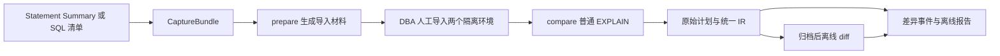

# 架构与文件契约

本文件描述当前 PCC Core 的公开接口与设计约束。功能的实际验证范围见 [validation.md](validation.md)；设计目标不能替代兼容性认证。

## 数据流



CLI 和 Python SDK 调用同一份核心。collector 负责 Summary、累计合并、筛选及依赖；capture 负责连接、SQL 守卫、EXPLAIN、取消和材料核验；plan 负责解析、匹配与差异；artifacts 负责文件发布、校验和与恢复；render 生成自包含 HTML 和 CSV。模块导入不连接数据库。

运行时为 CPython 3.11、PyMySQL 和 SQLGlot。SQLGlot 用于验证和依赖识别，不重写待测 SQL。工具不依赖平台服务、AI、Go、Docker 或任务队列。

## SQL 与参数

直接输入可使用 UTF-8 `.sql`，其中表名需要全限定；也可使用 JSONL，每行提供 `schema`、`sql_text`，以及可选的 `context`、`parameters` 和来源信息。SQL 原文、Hint、字面量与参数分别保留。

参数由 `type` 与 `value` 构成：

| 类型 | value 格式 |
|---|---|
| int / uint | 十进制字符串，64 位有符号/无符号范围 |
| decimal | 十进制字符串，最多65位精度、30位小数 |
| double | 有限浮点数字符串 |
| string | Unicode 字符串 |
| bytes | 十六进制字符串 |
| date | YYYY-MM-DD |
| datetime | YYYY-MM-DD HH:MM:SS.ffffff |
| time | [-]HHH:MM:SS.ffffff |
| json | 合法 JSON 字符串，绑定时转换为 SQL JSON |
| bool | JSON true / false |
| null | JSON null |

`parameters: []` 表示无参数的 Prepared Statement；省略字段表示普通文本 SQL。同一模板的不同参数分别生成样例。参数参与 query_id 与恢复指纹，不能只按 SQL digest 合并。

缺原文、缺参数、未绑定问号、仅有 EXECUTE/arguments 文本或截断样例时保留占位项并标记 needs_sample，不补猜参数。DDL、事务控制、管理命令和不支持的语法不能作为普通业务计划比较；守卫拒绝多语句、EXPLAIN ANALYZE、OUTFILE、任意 SET、SET_VAR Hint 和锁定读。

## Summary 与排名

五个指标分别排名后取并集，默认每榜全局 Top 20；只有显式 `--ranking-scope per_schema` 才逐库排名。平均延迟为总延迟除以总次数，扫描键数由同一快照的 AVG_TOTAL_KEYS × EXEC_COUNT 估算并标记 approximate。缺指标返回 METRIC_UNAVAILABLE，不填零。

业务窗口为 `[begin,end)`，选取与其相交的 Summary 原窗口累计值，不按分钟摊分。相同计数器多轮采集保留单调累计版本；例如同一实例10→15→20次和迟到11次仍为20，另一实例7次合计27。计数器重置或无法判定的变化记录歧义，不盲目累加。source epoch 未知也会显式记录。

watch 生成带哈希的 JSONL 文件队列，可重启、重复读取和按窗口筛选；它不是 TiDB 原生 Summary 磁盘持久化。旧19列 HEX TSV 和只读 `pcc_repository.stmt_summary_window` 不含扫描键指标，须显式选择 `execution_count,total_latency,average_latency`。旧包内 shell 和 `top_sql_selection.sql` 不会被当成业务 SQL 执行。

## 材料与计划

CaptureBundle 保存原 SQL、参数、来源、排名、SHOW CREATE DATABASE/TABLE/VIEW、依赖顺序、Status API 原始统计 JSON、精确版本和上下文。SQL 历史窗口、DDL 与统计的采集时刻不同，不能当作事务一致的历史快照。

prepare 只生成导入及核验材料。两端必须使用同一来源包、同名对象和相同源统计。compare 前后检查结构、统计与上下文；LOAD STATS 返回成功、两端 EXPLAIN 成功，都不自动证明统计完整或生产复现可信。

worker 独占连接，在同一连接执行 USE、白名单会话设置、普通 EXPLAIN 和紧随的 SHOW WARNINGS。SQL 与 Status 端点须核对同源。原始结果先保存，row 和 tidb_json 进入同一 IR。

归一化只消除临时算子 ID、数字表示等已确认的噪声。FullScan / RangeScan、PointGet / BatchPointGet、索引、范围、分区、Join 顺序与 Build/Probe 角色保留。未知属性保留原文，匹配有歧义时不任意配对。估算变化和 cost 不是性能倍率。

## 状态与产物

| 层次 | 状态 |
|---|---|
| capture_status | ok / failed / skipped / needs_sample |
| parse_status | ok / partial / failed |
| compare_status | same / changed / incomparable / not_run |
| run_status | completed / partial / blocked / interrupted |

same 仅用于完整支持、材料满足条件的比较。未知语义、严重匹配歧义、缺材料不能计为 same。完整比较率分母包含选定的缺样例占位项；它不是全部业务 SQL 覆盖率。

```text
capture_bundle/
  manifest.json, queries.jsonl, context.json, selection.json
  table_list.txt, skipped_tables.txt, issues.jsonl
  metadata_backup/, statistics_backup/

comparison_result/
  manifest.json, summary.json, items.jsonl, diffs.jsonl, issues.jsonl
  inputs/, plans/, ir/
  events.jsonl, checkpoint.json, differences.csv, report.html
```

JSON 中计数、纳秒和估算数值使用十进制字符串，内部使用 int / Decimal。文件清单包含哈希及契约、IR、归一化、匹配、差异算法版本。业务结果指纹排除运行时间等非业务元数据；恢复还核对材料、精确版本和上下文。

输出经校验、fsync 和原子 rename 发布，不覆盖已有目录。中断工作留在同级 `.name.partial`，恢复须显式使用 `--resume`。离线 diff 只消费归档，不读取连接配置或凭据。详细运行边界见 [operations.md](operations.md)。
